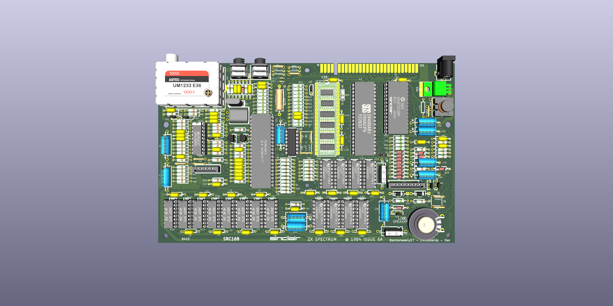
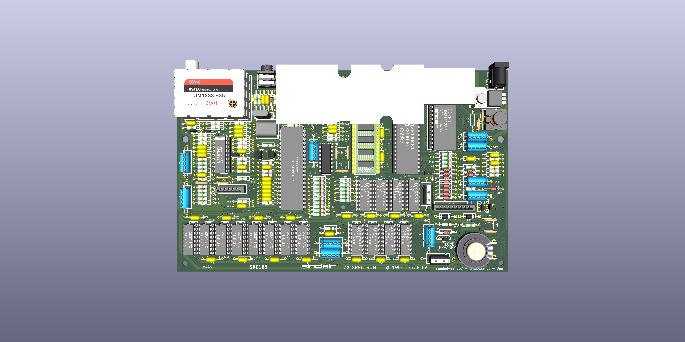

This Kicad 10 project and was only used to create an ibom with tracks to assist in the debugging of faulty boards. While the routing should be correct, the track widths have not been followed exactly, nor have component tolerances. Use at your own risk.

The ZX Spectrum Issue 6A PCB used for this has an MFG date of 8443, a silkscreen FAB revision of SRC168, a topside FAB revision of SRC166 and a solder side FAB revision of SRC167.

The created schematic was based on the physical layout of the PCB and appears to show the DC-DC circuit from a revision 4A PCB where capacitor C79 is before R79 and D19 is after R79 on the -5V line. which is not the same as the schematics available around the web show.

Note that R32 is fitted as a 0R link on this PCB.

Resistor and capacitor values in the schematic are taken from the Service Manual Revision 1.3 that was edited by Brendan Alford and appear to differ in various locations compared to various available schematics. Where they differed I have used the values from the PCB I was given by HappyLittleDiodes(Jim).

For the Ferranti ULA, do not fit R90, C100, C102, C103 and leave LK1, LK2, LK3 and LK4 open.

On the PCB I received, LKU and LKV were also open.

On the board I received,

C30 	22nF		Not Required for Saga ULA
C32 	100nF		Not Required for Saga
C35 	100nF		Not Required for Saga, Saga 10nF
C52/C53 150pF		Not Required for Saga
C67 	100pF		Not Required for Saga
C68-C71 100nF		Not Required for Saga
C76 	22nF		Not Required for Saga
C100	Not Fitted. 	For VHF 10nF
C101 	Not Fitted. 	For VHF 22nF
C102 	Not Fitted
C103 	Not Fitted

R17-R23 470R		Issue 5 Only?
R24 	1K		If TR3 is KSC839 should be 15K
R33 	680R		For Saga 560R
R34 	15R 0.5/1W
R48 	2K2		Not Required for Saga
R49 	10K		Not Required for Saga
R50 	4K7		Not Required for Saga
R51 	2K2		For Saga 1K2
R56 	1K		Not Required for Saga
R63 	1K		Not Required for Saga
R65-R67 10K		Not Required for Saga
R68 	6K8		Not Required for Saga
R69 	10K		Not Required for Saga
R73 	1K		Not Required for Saga
R74/R75 10K		Not Required for Saga
R76/R77 1K		Not Required for Saga
R80-R86 1K		Issue 5 Only?

I would not use these gerbers to manufacture a PCB without a lot more checking as that is NOT why it was done.

Have fun.